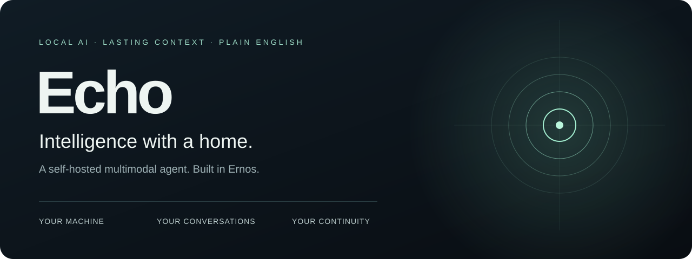
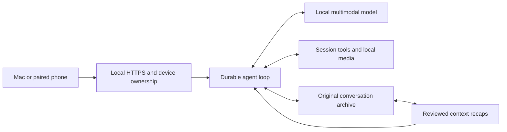

# Echo · Local AI agent with persistent context

**Talk, see, create and pick up where you left off. On your own machine.**

Echo is a self-hosted, multimodal AI agent written in **plain-English Ernos**. It brings local LLM inference, a modern browser chat interface, tool use, voice playback and a durable conversation archive into one system. Open it on your Mac or pair a phone on the same Wi-Fi.

**[Explore the system](docs/ARCHITECTURE.md) · [Set up Echo](docs/BUILD-AND-TEST.md) · [Read the documentation](docs/README.md) · [See the roadmap](phase2.md)**

---

## A conversation that can keep going

Long conversations need more than a larger context window. Echo keeps original messages and tool results locally, builds source-linked recaps when active context needs compaction, and can reread the originals later. A recap is inspectable and fallible; the archive remains the reference.

Your current task, earlier decisions and the sources behind an answer have somewhere to live.

## What you can do today

| Experience | What Echo provides |
| --- | --- |
| **Chat with a local multimodal model** | The current default uses one Qwen model through llama.cpp for text, image understanding and tool loops. MLX adapter code is also present. |
| **Work across turns** | A durable ReAct loop calls tools, reads results and continues until an answer or explicit stopping state. |
| **Bring your files** | Upload images, UTF-8 text and PDFs. Preview image thumbnails, inspect source passages and expand the sources read beneath a reply. |
| **Hear the answer** | Speak generates saved Kokoro audio beside the message, with playback, seeking and download. Local transcription is implemented; physical microphone permission acceptance remains deferred. |
| **Follow the work** | Each response retains an expandable Thinking panel with archived activity, tool calls/results and reasoning output when the provider emits it. |
| **Recall earlier chats** | Private cross-session search and original-source reading preserve event references and digests. Evidence-linked fact/episode recording, graph recall and individual derived-record withdrawal/restoration are also available through tools. Automatic consolidation and procedural learning remain Phase Two work. |
| **Explore another direction** | Branch conversations, edit and regenerate messages, search history and export records. |
| **Use your phone** | Pair individual browsers over local HTTPS. Ownership checks keep each paired browser’s sessions separate. |
| **Inspect and recover** | Saved submissions, effect records, crash diagnostics and backup/restore tools make failures investigable. |

## Local inference. Explicit capabilities.

Echo runs on the host machine; the current installation uses an Apple Silicon Mac Studio. Large assets can live on external storage while active runtime files and the conversation database run internally.

Provider metadata and exact preflight counting inform context admission. There is no fixed agent tool-turn ceiling. Available memory, model architecture and backend support still determine what can run. The current default supports text and images; audio uses explicit local Whisper and Kokoro services. Video metadata has been observed but a complete video workflow is not yet qualified.

See the [unified multimodal implementation](docs/UNIFIED-MULTIMODAL.md), [speech system](docs/KOKORO.md) and [security boundaries](docs/SECURITY-AND-DATA.md).

## Built to be understood

Echo’s application, browser client and test sources are written in Ernos. Native executables and browser JavaScript are generated from that source. The repository documents how a message moves through authentication, context assembly, generation, tool execution and the archive.

**482 application and test source files** are indexed with hashes, imports and definition signatures. The forensic reference distinguishes implemented behavior, observed tests and deferred work. It does not turn a file count into a test-coverage claim.

| You want to… | Start here |
| --- | --- |
| Understand the current state | [Status and known limits](docs/STATUS.md) |
| Follow a message through the system | [Architecture](docs/ARCHITECTURE.md) |
| Integrate with the local API or inspect tools | [24 HTTP routes and 16 tool contracts](docs/API-AND-TOOLS.md) |
| Find a source file or definition | [Application reference](docs/reference/APPLICATION.md) |
| Reproduce checks | [Build and tests](docs/BUILD-AND-TEST.md) · [Test reference](docs/reference/TESTS.md) |
| Pair, operate, back up or recover Echo | [Operations](docs/OPERATIONS.md) |
| Trace prompt inheritance | [Prompt migration](docs/PROMPT-MIGRATION.md) |
| Continue development responsibly | [Maintainer handover](docs/MAINTAINING.md) |

## Get started

This is a source distribution with a working Mac installation, not yet a portable one-click installer.

1. **Read the prerequisites.** Use the pinned Ernos compiler and integration overlay described in [build and test](docs/BUILD-AND-TEST.md) and [dependency provenance](docs/PROVENANCE.md).
2. **Configure local inference.** Obtain compatible model weights separately, then adapt the [configuration examples](config/examples/) to your paths and provider capabilities.
3. **Build and launch.** Generate the native commands and browser bundle, configure the local service and HTTPS gateway, and follow [operations](docs/OPERATIONS.md).
4. **Pair your browsers.** Create a one-use invitation on the host for each browser. On a phone, use the Mac’s LAN address; `127.0.0.1` refers to the phone itself.
5. **Verify your installation.** Exercise a real conversation, image input and the tools you configured. Read the [verification record](docs/forensics/release-verification.json) for the scope of retained evidence.

Model weights, live configuration, identity files, conversations, credentials and raw private evidence are separate local assets, excluded from the current source tree.

## Where Echo goes next

[Phase Two](phase2.md) is a dependency-ordered plan for Discord, scoped multi-user memory, richer tools, reusable tool creation, research and self-improvement interfaces, Gmail and optional external providers. It also carries forward explicitly deferred Phase One work. **Implementation has begun; these capabilities are not yet qualified.** The full decentralized agent network is a longer-term direction.

The final Phase Two prompt work is reserved for a joint review with Maria.

## Help shape Echo

For a reproducible problem, [open an issue](https://github.com/MettaMazza/Echo/issues) with the source revision, platform, provider, observed status and redacted reproduction steps. The [maintainer guide](docs/MAINTAINING.md) explains which diagnostics help and what must remain private.

Echo is maintained by [MettaMazza](https://github.com/MettaMazza). No project-wide software licence has been selected yet; repository visibility is not an open-source licence. Upstream dependencies and models retain their own terms.
